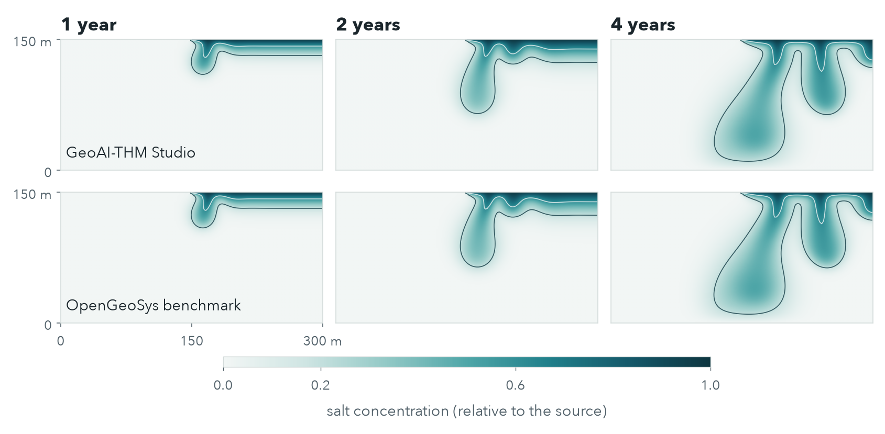
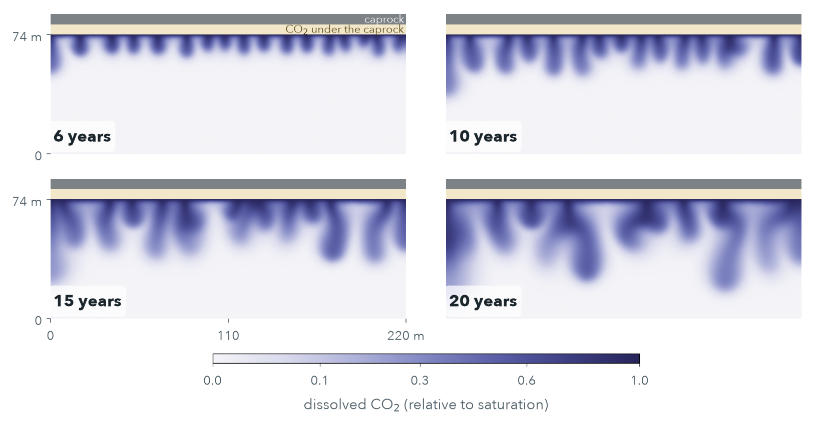
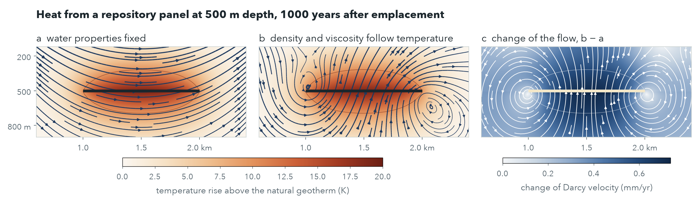

# GeoAI-THM Studio

**지하의 열, 지하수 흐름, 변형, 물질 이동을 말로 요청하면 모델을 만들고 OpenGeoSys로 계산해 주는 에이전트**

GeoAI-THM Studio는 다중물리 해석 프로그램에서 엔지니어가 밟는 단계를 그대로 밟습니다. 기하, 물리, 재료, 경계조건,
격자, 해석 설정, 계산, 결과 순서입니다. 사용자가 한국어나 영어로 문제를 설명하면, 에이전트가 필요한 것만 몇 가지
묻고 도구로 모델을 조립합니다. 모델을 검사한 뒤 [OpenGeoSys](https://www.opengeosys.org) 6.5.8로 계산하고,
프로그램이 계산한 수치를 검증 근거와 함께 보고합니다.

v0.1(미리보기). 비상업적 이용은 무료입니다. OpenGeoSys 기반. 박은규, 김태유, 박장원(GeoAI Alignment, Inc.).
[](https://doi.org/10.5281/zenodo.23833219)




## 0.1.1에서 바뀐 것

- **요청으로 만든 격자를 기술노트에 실었습니다.** gpt-6.1-terra와 나눈 대화 기록에서, 벤토나이트 완충재 속 발열 처분 용기를
  요청하자 에이전트가 용기와 완충재–암반 경계 쪽으로 조밀한 격자를 만들었습니다(기술노트 그림 2, 기록
  `tests/final_api/nl_mesh_ledger.json`).
- **그림을 다듬었습니다.** 결과 분포도, 선 위 분포, 시간 변화, 격자 미리보기가 한 가지 양식을 씁니다. 글자를 키우고
  200 dpi로 저장하며, 물리량마다 한 색조의 색 척도를 쓰고, 범례와 색 막대가 그림을 가리지 않으며, 경계와 계면 선이 잘
  보입니다.
- 계산, 검증 사례, 검사는 0.1.0과 같습니다.

## 계산하는 것

검증된 구성만 계산합니다. 그 밖의 요청은 정중히 거절하고 GeoAI Alignment로 안내합니다.

| 구성 | 물리 | 형상 | 검증 |
|---|---|---|---|
| H-2D, H-AX-well, H-3D | 지하수 흐름(정상·과도) | 2D 단면·평면, 축대칭 우물, 3D 상자 | 층상 흐름, Theis 양수 시험, 정수압 |
| T-2D, T-3D | 열전도(발열 포함) | 2D, 원형 발열체, 3D 상자 | erfc 해, 발열 평판, 방사 전도 |
| TH-2D | 지하수 흐름에 따른 열 이동 | 2D | 이류-전도 해석해 |
| HC-2D | 물질 이동: 이류, 분산, 흡착, 붕괴 | 2D | Ogata–Banks, 점토 속 방사성 핵종 이동 |
| HC-2D-density | 밀도 차이로 생기는 흐름(예: 손가락 모양으로 가라앉는 소금물) | 2D 수직 단면 | OpenGeoSys 공식 Elder 벤치마크 |
| HM-2D | 압밀(평면변형률) | 2D | Terzaghi, Biot 계수 1 미만 |
| TM-2D | 열팽창과 열응력(평면변형률) | 2D | 열탄성 엄밀해 |
| THM-AX | 포화 암반 속 점 열원 | 축대칭 | Booker and Savvidou (1985) |
| THM-AX-repository | 벤토나이트로 채운 처분공 속 발열 처분용기(시연) | 축대칭 | 에너지 수지, 격자 수렴, 균질 극한 |

각 검증 사례는 OpenGeoSys 결과를 해석해나 OpenGeoSys 공식 입력과 비교하며, 허용 오차는 미리 정했습니다.
자세한 내용은 [docs/VERIFICATION.md](docs/VERIFICATION.md)에 있습니다. 구성은 그 사례가 설치된 GeoAI-THM Studio와
OpenGeoSys 판에서 모두 통과했을 때만 계산합니다. 사례 27개 가운데 21개는 오차 1 % 이내이고,
모두 2.5 % 이내입니다. 요소 크기와 시간 간격을 함께 반으로 줄이면 과도 문제의 오차도 반으로 줄어, 1차 시간 적분과 맞습니다.

**포함하지 않는 것:** 반응 화학, 이상유동·불포화 흐름, 벤토나이트 팽윤, 균열, 동결, 소성, 중력을 포함한 역학,
3차원 역학, 대형 모델과 실제 부지 모델. 구성 안에서도 검증 사례가 다루지 않는 입력은 거절합니다. 물질 유입
플럭스·유량 조건, 열·물질 이동과 함께 쓰는 수리 저류, 열 이동이나 역학과 함께 쓰는 물 유입 조건입니다(횡분산은 경고와 함께 계산합니다). 이런 해석은 GeoAI Alignment, Inc.(https://geoaialign.ai)가 서비스로
제공합니다.

## 작동 방식

언어 모델은 OpenGeoSys 입력을 직접 쓰지 않고 수치를 계산하지도 않습니다. 약 스무 개의 도구로 형식이 정해진 모델
트리를 바꾸고, 번역기가 그 트리를 OpenGeoSys 입력으로 만듭니다.

- **상태 기계가 순서를 정합니다.** 현재 단계에 맞는 도구만 보입니다(한 번에 4–6개). 맞지 않는 도구를 부르면 실패
  대신 현재 상태와 다음 단계를 돌려줍니다. `run`은 현재 판의 모델이 `check_model`을 통과해야 실행되며, 모델을
  고치면 검사 결과가 무효가 됩니다.
- **격자는 독립된 단계입니다.** 요소 크기, 경계·계면 쪽 쏠림, 국부 세분, 요소 모양, 품질 검사(각도, 종횡비,
  야코비안, 영역 면적의 기하 대조, OpenGeoSys checkMesh), 해상도 권고(셀 Péclet 수, 확산 거리), 격자 수렴 비교를
  제공합니다.
- **비교는 이름이 정해져 있습니다.** `compare`는 같은 모델에서 결합 하나(고체·물의 열팽창, Biot 결합, 흡착, 붕괴)를
  끄거나 요소 크기를 절반으로 줄여 다시 계산하고 차이를 보고합니다.
- **수치는 answer card에서 나옵니다.** `answer_card`가 보고할 값을 실행 ID, 모델 이름, 위치, 시각, 검증 상태와 함께
  계산합니다. 출력 guardrail은 카드, 모델 입력값, 사용자가 쓴 말에 없는 수치가 답에 들어가면 막고 답을 다시 쓰게
  합니다. 쓰인 자릿수까지 반올림해 대조하며 부호는 비교하지 않습니다("3.06 m 내려간다"는 −3.06 m 변화와 맞습니다).
  단위가 붙은 수치는 같은 종류의 출처에서 와야 합니다(온도는 온도에서, 밀도에서가 아니라). 도구가 지나가며 보고한
  수치는 개수, 시간, 길이, 백분율에는 쓸 수 있지만 온도, 압력, 속도, 유량의 근거가 되지 못합니다. 온도나 농도가 초기값과 고정값의 범위를
  벗어나면 카드가 경고합니다. 흐름에 비해 격자가 성기다는 신호입니다.
- **결과 페이지.** 답마다 HTML 페이지가 생깁니다. 카드, 그림, 오프라인 3D 화면, 검증 상태, 번역기가 한 단위
  환산을 모두 보여 줍니다.

## 설치

지원: Apple Silicon의 macOS 15 이상, Python 3.12. 실험적 지원: Linux x86_64(지금까지 에뮬레이션에서만 시험, 아래 참고).
Windows는 지원하지 않습니다.

소프트웨어는 비상업적 이용에 무료이지만, 대화 에이전트는 사용자의 키로 OpenAI API를 호출하며 그 사용료는 OpenAI가
사용자 계정에 청구합니다. 다른 MCP 클라이언트에서 도구를 쓸 때는 그 클라이언트 모델의 이용 조건을 따릅니다.

```bash
pip install "geoai-thm-studio[mesh-gmsh] @ git+https://github.com/geoaialignment/geoai-thm-studio@v0.1.1"
```

`mesh-gmsh`는 원형 포함체와 삼각형 격자에 쓰는 gmsh를 설치합니다. gmsh는 별도 프로그램으로 실행됩니다.
Linux에서는 최소 설치 이미지에 없는 시스템 라이브러리가 gmsh에 필요합니다(Debian, Ubuntu):

```bash
sudo apt-get install libgl1 libglu1-mesa libgomp1 libxcursor1 libxft2 libxinerama1
```

삼각형 격자를 처음 계산하기 전에, 설치된 엔진이 답을 아는 작은 시험 문제를 풉니다. Linux x86_64용 OpenGeoSys 6.5.8은
Apple Silicon의 에뮬레이션에서 이 시험을 통과하지 못했고, 같은 입력이 macOS와 사각형 격자에서는 정확했습니다. 실제
Linux 기계에서는 아직 시험하지 못했습니다. 시험에 실패한 컴퓨터에서는 삼각형 격자를 거절하고 사각형 격자는 그대로
계산합니다.

## 사용

대화(환경 변수 `OPENAI_API_KEY`에 OpenAI API 키가 필요합니다):

```bash
thmstudio chat --model gpt-6.1-terra
```

Claude Desktop 같은 MCP 클라이언트에서는 서버를 추가합니다:

```json
{"mcpServers": {"thm-studio": {"command": "thmstudio", "args": ["mcp"]}}}
```

그 밖의 명령: `thmstudio examples`는 시작 예제 13개를 보여 주고, `thmstudio verify`는 검증을 사용자 컴퓨터에서
다시 실행합니다.

## 작은 모델로 한 시험

이 프로젝트가 보이려는 것은 harness를 잘 만들면 작은 모델도 모델링 작업을 끝까지 해낸다는 점입니다. 개발과 시험에는
OpenAI API를 쓰지 않았습니다.

- **대역 시험.** 작은 모델 대역인 Claude Haiku 5.5가 MCP 서버로 시나리오 21개를 풀었습니다. 공개판 guardrail과
  채점 기준으로 20개가 통과했습니다(개발 중 다섯 차례 반복한 마지막 회차이며, 회차 사이에 같은 시나리오를 보며
  harness를 고쳤습니다). s20은 지원하지 않는 정상 상태 물질 이동을 요청받자, 요청대로는 계산할 수 없다고
  말하는 대신 과도 모델을 1년 돌리고 가득 찬 기둥을 정상 상태라고 불렀습니다. 이번 공개를 위해 다시 채점하면서
  guardrail 결함 두 개를 찾아 고쳤습니다. 요청에서 한글 바로 앞에 붙은 숫자("10도")를 사용자 숫자로 읽지 못했고,
  카드에 있는 시간 단계 수를 인용할 수 없었습니다.
- **OpenAI API 최종 확인**은 10달러 상한으로 한 번 돌렸습니다. 시나리오 8개를 gpt-6-luna와 gpt-6.1-terra로 풀었고,
  16번 모두 카드를 만들고 카드의 수치만 인용했습니다. 계량된 비용은 1.18달러이고, 비용이 집계되기 전에 멈춘 시도 두 번에
  0.40달러를 따로 잡아 모두 1.58달러입니다. s01에서는 위의 guardrail 결함 때문에 두 모델의 첫 답이
  되돌려졌고, 두 모델 모두 답을 다시 썼습니다.
- **최종 확인에서 찾은 것.** 답마다 예제의 원래 격자로 다시 계산해 보니 s11은 두 모델 모두 틀렸습니다. 둘 다 점 열원
  격자를(gpt-6-luna는 그 주변까지) 성기게 바꿨고, 간극수압 상승이 -0.507 MPa(gpt-6-luna)와 0.635 MPa(gpt-6.1-terra)로
  나와 엄밀해 0.967 MPa와 달랐습니다. gpt-6.1-terra는 요소를 절반으로 줄인 비교에서 0.257 MPa 차이를 보고 격자에
  민감하다고 적었지만 그 값을 그대로 답으로 냈습니다. 먼저 첫 출력 시각까지 열이 퍼진 거리의 4분의 1보다 큰 요소를
  거절하는 규칙을 넣었고, 이 규칙으로 다시 돌리자 gpt-6.1-terra는 격자를 거절당한 뒤 세분해 0.971 MPa를 보고했습니다.
  그 뒤 열원 요소 크기를 바꿔 가며 계산해 보니(`results/point_source_sweep.json`) 4분의 1에서도 오차가 약 6 % 남아,
  공개판 `check_model`은 8분의 1보다 큰 요소를 거절합니다. 이 크기는 예제를 검증 사례의 허용 오차 3 % 안에 둡니다.
  두 모델은 계산한 14번 가운데 9번 예제 격자를 바꿨지만 다른 시나리오에서는 영향이 없었고, 다시 계산한 값은 2.3 %
  안에서(23개 가운데 20개는 0.2 % 안에서) 같았습니다. 또 `thmstudio chat`이 두 번째 질문마다 실패하던 결함(event loop
  오류)을 찾아 고쳤습니다.
- **Linux**는 에뮬레이션(Apple Silicon의 Docker)에서만 시험했습니다. 설치, 사각형 격자 예제, 검증 사례는 통과했고
  삼각형 격자는 통과하지 못했습니다(설치 참고).

대화 기록은 [docs/EXAMPLE_CONVERSATION.md](docs/EXAMPLE_CONVERSATION.md)에 있습니다.

## 시연: 공개판 너머

같은 엔진(OpenGeoSys 6.5.8)으로 GeoAI Alignment가 만든 두 계산입니다. 이번 공개판이 검증한 구성 밖이며, 다른 코드나 현장
자료와 대조하지 않았습니다. 이런 해석은 서비스로 제공합니다.



*CO2 저장: 덮개암 아래 CO2가 염수에 녹으면 염수가 약 1 % 무거워져 손가락 모양으로 가라앉습니다. 투수율 2×10⁻¹² m²(±10 %
불균질), 확산과 분산을 합친 계수 10⁻⁷ m²/s. 광물 반응과 기체 상의 흐름은 계산하지 않았습니다.*



*고준위 방폐장: 깊이 500 m 처분 패널의 붕괴열(5 W/m², SKB 기준 사용후핵연료처럼 감소)이 물을 가볍고 묽게 만들어, 흐름의
변화(c)에 두 개의 순환이 생깁니다. 투수율 10⁻¹⁵ m². 2D 단면의 패널 평균이며 처분 용기·완충재 계산이 아닙니다.*

## 문서와 인용

- 기술노트: [한국어](docs/technical_note/GeoAI-THM-Studio-v0.1.1_technical_note_ko.pdf),
  [영어](docs/technical_note/GeoAI-THM-Studio-v0.1.1_technical_note_en.pdf)
- 프리프린트(ESS Open Archive 제출됨, 심사 중): [PDF](docs/preprint/GeoAI-THM-Studio_preprint.pdf)
- 검증 표: [docs/VERIFICATION.md](docs/VERIFICATION.md)

인용: Park, E., Kim, T., & Park, J. (2026). *GeoAI-THM Studio* (Version 0.1.1) [Software]. GeoAI Alignment, Inc.
Zenodo. https://doi.org/10.5281/zenodo.23833219

## 라이선스

코드: PolyForm Noncommercial License 1.0.0([LICENSE](LICENSE)). 문서·예제·검증 보고서: CC BY-NC 4.0
([LICENSE-docs.md](LICENSE-docs.md)). 상업적 이용은 허용하지 않습니다. 제3자 구성요소는 각자의 라이선스를
따릅니다([THIRD_PARTY_NOTICES.md](THIRD_PARTY_NOTICES.md)).

결과는 학습과 초기 추정용이며 설계, 인허가, 안전성 평가의 근거로 쓸 수 없습니다.

문의: GeoAI Alignment, Inc., https://geoaialign.ai
