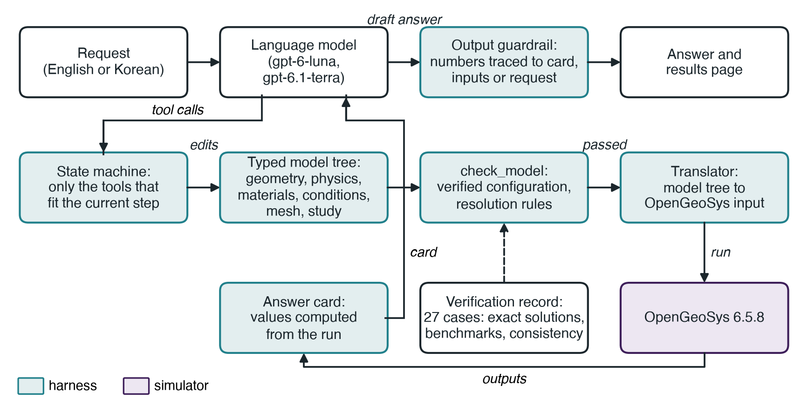
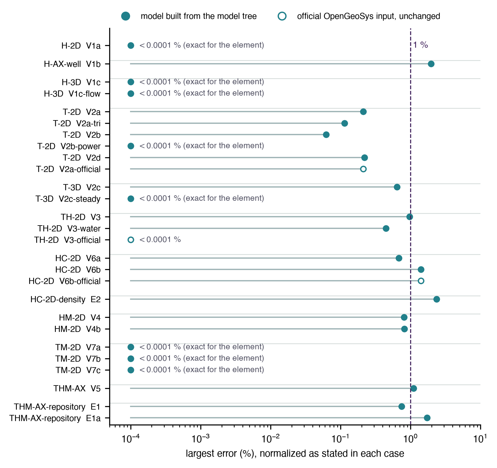

# Key points

- An agent turns a request in English or Korean into an OpenGeoSys model through the steps of a multiphysics program, from geometry and mesh to results, and checks the numbers in its answers against the run, the model inputs and the request
- It computes twelve configurations of heat, groundwater flow, deformation and solute transport, each backed by verification cases; {{cases_within_1pct}} of the {{cases}} cases agree with their references within 1 % and all within 2.5 %
- In the final check with two small OpenAI models every checked number in every answer was traced, yet both models answered one heat-source question wrongly after coarsening the mesh, which led to a new resolution rule

# Summary

GeoAI-THM Studio is a free, noncommercial agent that builds and runs subsurface models of heat conduction, groundwater flow, heat transport by flowing groundwater, solute transport, consolidation, thermal stress and coupled thermo-hydro-mechanical (THM) processes with OpenGeoSys 6.5.8. A user describes a problem; the agent asks at most a few questions, assembles the model through about twenty tools in the order of a multiphysics graphical program (geometry, physics, materials, conditions, mesh, study, computation, results), checks it, runs it, and answers with the values computed from the run, the verification behind them and a results page. The language model never writes simulator input, and the numbers it reports are computed by the program; the tools, checks and translator around it, together with a check of the numbers in each answer, form the harness. This note describes how the agent works, the {{cases}} verification cases behind its twelve configurations, the tests with small language models, installation and use, and the limits of version 0.1. It is written for groundwater and radioactive-waste researchers and engineers who want a first estimate of a coupled problem without a commercial licence, and for anyone who wants to see what an agent needs to run a simulator responsibly.

# 1. Purpose

Coupled models of the subsurface answer questions that recur in groundwater and radioactive-waste work: how far heat from a canister spreads into the buffer and the rock, how much the pore pressure rises around a heat source, how a pumping well lowers the water level, how fast a tracer or a radionuclide moves, how much a clay layer settles under a load. Commercial multiphysics programs answer them through a graphical interface, and open simulators such as OpenGeoSys (Bilke et al., 2019; Kolditz et al., 2012) answer them through input files that take time to learn. GeoAI-THM Studio puts a language model in front of OpenGeoSys so that the question can be asked in a sentence, while the checks on the model description, the input files, the computation and the reported numbers stay with the program.

Version 0.1 is a preview for learning and first estimates. It solves two-dimensional, axisymmetric and simple three-dimensional problems of the kinds listed in Section 3, refuses requests outside them, and is not meant for design, licensing or safety assessments. Large three-dimensional, site-specific and three-dimensional mechanical models are services of GeoAI Alignment, Inc.

# 2. How a request becomes a result

**The model tree.** Every model is a model tree, a typed description in six parts that follow the steps of a multiphysics graphical program. The geometry is a layered rectangle, a circular inclusion, a layered box or an axisymmetric shape around a well or a heat source. The physics names the process and its couplings. Then come materials for each region, boundary and initial conditions with sources, mesh settings, and the study, which is steady or transient with an end time, time steps and output times. Every value carries a unit ("20 degC", "1e-5 m/s", "10 yr") and is converted to SI units. Thirteen starting examples (listed by `thmstudio examples`, Section 5) fill the tree for common problems, from surface heating of rock and a pumping well to a heated canister in a bentonite-filled hole and the Elder problem of sinking salt water.

**Tools and steps.** The language model changes the tree only through tools, ordered by a state machine (Figure 1). In the chat agent the model sees only the tools that fit the current step, four to six while the model is a draft and only the status tool while OpenGeoSys runs; through the Model Context Protocol all 21 tools are listed, and the same state check applies when a tool is called. A call that does not fit returns the state and the next step instead of failing. Any edit invalidates an earlier pass of the model check described below, and an edit that fails leaves the model unchanged. The agent asks at most three questions per model, each with a default. When the user says "use sensible defaults", it takes the values of the starting example or of the materials library (Table A1) and says which values are defaults.

**The mesh step.** Meshing is a full step, as in a graphical program. The structured mesher builds quadrilateral or hexahedral elements with a target size, grading towards boundaries and interfaces, and local refinement around named targets such as a well, a heat source or a canister. Gmsh (Geuzaine & Remacle, 2009), run as a separate program, builds triangle meshes and the circular inclusion. Every mesh is checked for element angles, aspect ratios and Jacobians, for region areas against the geometry and with the OpenGeoSys mesh checker, and a picture of the mesh can be shown before the run (thresholds in Table A1). The check then gives resolution advice. It reports the cell Péclet number of transport models and compares the elements at fixed-temperature boundaries with the distance heat spreads by the first output, ℓ = √(κt₁), where κ is the smallest thermal diffusivity of the materials and t₁ the first output time. At a point heat source it refuses elements larger than ℓ/8 (Section 4). The tool compare reruns a model with half the element size (the time steps are kept) and reports the largest absolute difference at the requested point or line.

**Check, translation and computation.** Before a run, the tool check_model must pass. It refuses configurations without passed verification (Section 3), most inputs that the verification does not cover, conflicting conditions on boundaries that share elements, misspelled region names and mechanical models without restraint. A translator then writes the OpenGeoSys input for the matching OpenGeoSys process (liquid flow, heat conduction, heat transport, component transport, hydro-mechanics, thermo-mechanics or thermo-hydro-mechanics), with linear elements for flow, heat and transport and quadratic displacement elements for mechanics, and OpenGeoSys runs as a separate process with limits on time and output size. If an iterative linear solver fails, the run is repeated once with a direct solver. Afterwards, every output file is read to confirm finite values, all solution fields and every requested output time.

**Answer card and guardrail.** The language model asks the tool answer_card for the values it wants to report, and the answer card is the table of these values computed from the run. An item can be a value at a point or probe, its change since the start, a maximum, minimum or mean, or the difference from a named comparison in which one coupling (thermal expansion of the solid or the water, Biot coupling, sorption, decay) is switched off. Each card row records the run, location, time and verification status. Where the initial and fixed values of a temperature or concentration define a range, the card warns when the result leaves that range by more than 1 % of its width. Before the answer reaches the user, an output guardrail checks that every number in it matches a card value, a model input or a number in the user's request. Numbers are compared without their sign and at the precision written in the text, against card values in the units shown and in SI units; a number written with a recognised unit must come from a card value or input of the same dimension (a card value may also be quoted as a percentage), while numbers from the request may back any value. Whole numbers that are not followed by a unit or a unit-like word are not checked if their absolute value is at most 10 or if they lie between 1900 and 2100 (years), and numbers that tools mention in passing may back counts, times, lengths and percentages but not temperatures, pressures, velocities or flow rates. If a number fails, the model must rewrite the answer once. The guardrail runs in the agent built on the OpenAI Agents SDK. When another program uses the tools through the Model Context Protocol, the card is available but that program's answer is not checked.

**Results page.** Each answer that reports computed values comes with an HTML page holding the card, figures, an offline three-dimensional view of the result, the verification status and the conversions the translator made.



# 3. Configurations and verification

A configuration is a combination of physics and geometry type. Version 0.1 has twelve (Table 1). Each has verification cases that build the model from the model tree, compute it with OpenGeoSys 6.5.8, and compare it with an exact solution, with the output of an official OpenGeoSys benchmark, or, for the one demonstration configuration, with consistency checks. Three further cases run official OpenGeoSys inputs unchanged, as baselines for the engine; they are reported in Table 1 but are not part of the rule below. Tolerances were written in each case file before the comparison, and errors are normalized as each case file states: by the largest change of the reference from its initial value, by the local change, or by a fixed scale such as 1 K. The references include the Theis (1935) solution for a pumping well, the complementary error function solution for heat conduction into a half-space (Carslaw & Jaeger, 1959), the Ogata and Banks (1961) solution and a radionuclide migration solution with sorption and decay (van Genuchten & Alves, 1982), Terzaghi consolidation (Terzaghi, 1943), exact thermoelastic solutions, the point heat source of Booker and Savvidou (1985) with the correction of Chaudhry et al. (2019), and the Elder (1967) problem of sinking salt water (Voss & Souza, 1987). {{halving_sentence}}

Each result is recorded with the package and OpenGeoSys versions that produced it, and a configuration is computed only when all its model-tree cases have passed with the installed versions. Users can repeat the cases with the command `thmstudio verify` (Section 5), and their own results then replace the release record; the four cases that read official OpenGeoSys inputs or outputs need a copy of the OpenGeoSys 6.5.8 test data (THIRD_PARTY_NOTICES.md).

All {{cases}} cases passed (Figure 2). {{cases_within_1pct}} agree within 1 %, and the largest errors are the Elder problem against the official benchmark output (2.3 %) and the Theis drawdown near a pumping well at early time (2.0 %). Cases whose solution is exact for the element type agree to round-off.

Where an official input and the agent's own model of the same problem are both compared with an exact solution, they agree with it equally well (0.21 % for heat conduction into a half-space, 1.4 % for radionuclide migration). For the Elder problem the salt fingers of the agent's model and of the official benchmark are indistinguishable at one, two and four years (Figure 3). In both, the concentration dips below zero next to the fingers (to −0.21 of the source concentration), an undershoot of the unstabilized method on this grid that the answer card reports as a warning. The heated canister in a buffer (THM-AX-repository) has no exact solution and is a demonstration: it is checked for energy balance, convergence under mesh refinement, region areas and a homogeneous limit equal to the point heat source; the largest check of its case E1, 0.75 %, is the change of pore pressure when the element size and the first time step are doubled (Figure 2).

*Table 1. Configurations and verification cases. Largest error: the largest normalized maximum-norm error of any comparison in a case (for the demonstration, the largest consistency check). Cases marked "official input" are engine baselines outside the rule that admits a configuration. Full tables: docs/VERIFICATION.md.*

{{TABLE1}}




**Inputs that are refused.** Within the configurations, most inputs that no case exercises are refused: prescribed solute flux or rate conditions, hydraulic storage combined with heat or solute transport, and prescribed water inflow combined with heat transport or mechanics. Transverse dispersion in solute transport, which no case observes, is computed with a warning. Requests outside the configurations, such as reactive chemistry, unsaturated or two-phase flow, bentonite swelling, fractures, freezing, plasticity, gravity in mechanical models and three-dimensional mechanics, are refused with a pointer to GeoAI Alignment, as are meshes above the element caps of Table A1.

# 4. Tests with small language models

The project set out to show that a careful harness lets a small model carry a modelling task through. All development and testing used no OpenAI model; the OpenAI API was used only in one final check at the end, with a cap of USD 10, which included reruns of one scenario after rule changes.

**Stand-in runs.** Claude Haiku 5.5 worked through 21 scenarios through the Model Context Protocol server, and the test runner applied the output guardrail to its answers. The scenarios include requests in English and Korean, full specifications and "use sensible defaults", two requests that must be refused and two that ask for settings the harness does not support (gravity with mechanics, steady solute transport), a follow-up change, a model built without an example, porosity written as a percentage and the Elder problem described in words. A run passed when it did what the scenario requires (for example ran and produced a card, refused with a pointer to the company, or used a named comparison) and its final answer passed the released guardrail; {{l6_passed}} of {{l6_n}} passed. These runs are the last of five rounds made during development, between which we improved the instructions, tools and guardrail on the same scenarios, so they measure a harness tuned on them. The failed scenario asked for steady solute transport, which is not supported; the model ran the transient model for a year and called the result steady instead of saying the request could not be met. Across the runs, {{l6_errors}} of {{l6_calls}} tool calls returned an error, each answered with the next step, and none ended a run.

**Final check with the OpenAI API.** Eight scenarios ran once each with gpt-6-luna and gpt-6.1-terra; three gpt-6-luna runs that failed before their first model call, because of an error in our test runner, were repeated. Both models refused the out-of-scope request without a run, the other 14 runs produced an answer card, and every checked number in every answer could be traced to the card, the inputs or the request. Apart from the request that both models refused, each of the first 16 runs took 11 to 23 tool calls. The check cost USD 1.58 in all, including an upper bound for two attempts that crashed before their cost was counted. Example conversations are in docs/EXAMPLE_CONVERSATION.md.

**What the check found.** We recomputed every answer with the mesh of the example it started from. The models had changed that mesh in {{mesh_changed}} of {{mesh_runs}} computed runs, often coarsening it near a well or a source, yet the recomputed values agreed within {{audit_other_max_pct}} % ({{audit_other_within_02}} of {{audit_other_n}} within 0.2 %) except in one scenario.

That scenario asks how much a 300 W point heat source raises the pore pressure in saturated rock. Both models had coarsened the mesh at the source, gpt-6-luna also around it, and reported −0.507 MPa and 0.635 MPa, against 0.967 MPa from the exact solution (Booker & Savvidou, 1985; Chaudhry et al., 2019), although both answers quoted only computed numbers.

A sweep of the element size at the source (Figure 4) shows the pressure approaching the exact value only when the elements there are well below the distance heat has spread by the first output, ℓ = √(κt₁), where κ is the thermal diffusivity and t₁ the first output time. We first added a rule refusing elements larger than ℓ/2, under which the models answered 0.998 and 0.887 MPa, and then ℓ/4; rerun with that, gpt-6.1-terra first had its mesh refused, then refined it and reported 0.971 MPa.

In that rerun gpt-6.1-terra took the suggested size ℓ/8, whereas the sweep showed that ℓ/4 itself still allows errors of about 6 %, so the released check_model refuses elements larger than ℓ/8, which keeps this example within the 3 % tolerance of its verification case, and suggests ℓ/12. gpt-6.1-terra had also run the half-element-size comparison in its first answer and called the value mesh-sensitive, but still reported it; no rule yet acts on such a comparison. The check also found an error that made `thmstudio chat` fail on every second question. While preparing this note we found and fixed two faults of the guardrail: numbers written next to Korean characters, and step counts quoted from the card. A companion preprint by the same authors, prepared for the ESS Open Archive, discusses what these results imply for agents that run simulators.


# 5. Installation and use

GeoAI-THM Studio is built for macOS 15 or later on Apple Silicon and for Linux x86_64, with Python 3.12; Linux has been tested only under emulation (below), and Windows is not supported.

```
pip install "geoai-thm-studio[mesh-gmsh] @ git+https://github.com/geoaialignment/geoai-thm-studio@v0.1.0"
```

The `mesh-gmsh` option installs Gmsh for circular inclusions and triangle meshes. On minimal Linux systems Gmsh needs six system libraries (`libgl1 libglu1-mesa libgomp1 libxcursor1 libxft2 libxinerama1` on Debian or Ubuntu). Before the first triangle mesh, the installed engine solves a small test problem with a known answer (Table A1); OpenGeoSys 6.5.8 for Linux x86_64 failed this test when we ran it under emulation on Apple Silicon, so triangle meshes are refused wherever it fails, while quadrilateral and hexahedral meshes still work. A test on a native Linux machine is still to be done.

The agent is used in a chat (`thmstudio chat --model gpt-6.1-terra`, with an OpenAI API key in the environment) or from any client of the Model Context Protocol, such as Claude Desktop (`thmstudio mcp`). `thmstudio examples` lists the starting examples and `thmstudio verify` repeats the verification on the user's computer.

# 6. Limits

Version 0.1 covers the twelve configurations of Table 1 and nothing else. Results are for learning and first estimates. The tests are small: in the reported rounds each scenario ran once per model, apart from the reruns of the point-source scenario after rule changes, and the stand-in results are the last of five development rounds on the same scenarios, and the scenarios, the guardrail and the scoring rules are ours. All results were computed on macOS; Linux was tested only under emulation. The output guardrail checks where the numbers come from, not whether the model that produced them is adequate. Among the choices of discretization, only the mesh at a point heat source is guarded by a resolution refusal; the other resolution checks are advice, and the verification cases and the results page let users judge the rest.

# 7. Licence, citation and contact

The code is licensed under the PolyForm Noncommercial License 1.0.0, and the documentation, examples and verification reports under CC BY-NC 4.0, so commercial use is not permitted. Third-party components keep their own licences: OpenGeoSys is under BSD 3-Clause, and Gmsh, under the GPL, is run only as a separate program. Please cite the release as Park, E., Kim, T., & Park, J. (2026). GeoAI-THM Studio (Version 0.1.0). GeoAI Alignment, Inc. https://doi.org/{{doi}}. The source is at https://github.com/geoaialignment/geoai-thm-studio, and GeoAI Alignment, Inc. can be reached at https://geoaialign.ai.

The authors work for GeoAI Alignment, Inc., which develops and distributes the software free of charge for noncommercial use and offers commercial modelling services beyond its scope. Beyond this, the authors declare there are no conflicts of interest for this note. Claude (Anthropic) was used to write and test the code and to draft this note, and other language models reviewed the code and the text. The authors checked the results and are responsible for the content.

# Appendix A. Settings and checks

*Table A1. Settings and checks of version 0.1.0. ℓ is the heat-spread length of Section 4.*

| Item | Setting |
|---------------------|----------------------------------------------------------------|
| Software | OpenGeoSys 6.5.8 (Python wheel); Gmsh 4.15.2, run as a separate program; OpenAI Agents SDK 0.24.0; Model Context Protocol SDK 2.3.0; Python 3.12 |
| Verification tolerances | per case, written before the comparison: typically maximum-norm and relative l2 errors of 1–3 % for transient solutions and 10⁻⁶ where the solution is exact for the element; every case is listed with its tolerance in docs/VERIFICATION.md |
| Mesh checks | inverted elements refused; angles below 30° (quadrilaterals) or 15° (triangles) and aspect ratios above 20:1 give warnings; region areas compared with the geometry; at most 15,000 elements for coupled mechanics, 60,000 in 2D and 120,000 in 3D otherwise |
| Resolution rules | cell Péclet number vh/(2D) above 1 (v pore velocity, h largest element size, D dispersion coefficient), or its thermal equivalent: warning; front moving more than one element per time step (vΔt/h > 1): warning; in transient heat conduction and heat transport (T, TH), element at a fixed-temperature boundary larger than ℓ/2 and (for materials given with density and specific heat) heat spreading beyond half the model size by the end time: warnings; element at a point heat source larger than ℓ/8: refused, ℓ/12 suggested |
| Named comparisons | no thermal expansion of the solid; no thermal expansion of the water; no Biot coupling; no sorption (retardation 1); no decay; half element size (sizes halved, divisions doubled) |
| Card values | value at a point or probe (interpolated within the element); change since the start; maximum, minimum or mean of the nodal values over the model or of 201 samples along a line; largest absolute difference from a named comparison |
| Engine self-test | steady conduction across a 2 m strip from 300 K to 290 K on a triangulated mesh; passes if the largest error is below 10⁻⁶ K; repeated once per OpenGeoSys version and platform |
| Default materials | representative values with sources in src/thmstudio/agent/kb/materials.json |
| Scenarios and scoring | tests/l6/scenarios.json (requests and expected outcomes), tests/l6/run_l6.py (judge), tests/final_api/run_final.py (API check), results/ and runs/ (records) |

# References

Bilke, L., Flemisch, B., Kalbacher, T., Kolditz, O., Helmig, R., & Nagel, T. (2019). Development of open-source porous media simulators: Principles and experiences. *Transport in Porous Media*, *130*(1), 337–361. https://doi.org/10.1007/s11242-019-01310-1

Booker, J. R., & Savvidou, C. (1985). Consolidation around a point heat source. *International Journal for Numerical and Analytical Methods in Geomechanics*, *9*(2), 173–184. https://doi.org/10.1002/nag.1610090206

Carslaw, H. S., & Jaeger, J. C. (1959). *Conduction of heat in solids* (2nd ed.). Oxford: Clarendon Press.

Chaudhry, A. A., Buchwald, J., Kolditz, O., & Nagel, T. (2019). Consolidation around a point heat source (correction and verification). *International Journal for Numerical and Analytical Methods in Geomechanics*, *43*(18), 2743–2751. https://doi.org/10.1002/nag.2998

Elder, J. W. (1967). Transient convection in a porous medium. *Journal of Fluid Mechanics*, *27*(3), 609–623. https://doi.org/10.1017/S0022112067000576

Geuzaine, C., & Remacle, J.-F. (2009). Gmsh: A 3-D finite element mesh generator with built-in pre- and post-processing facilities. *International Journal for Numerical Methods in Engineering*, *79*(11), 1309–1331. https://doi.org/10.1002/nme.2579

Kolditz, O., Bauer, S., Bilke, L., Böttcher, N., Delfs, J. O., Fischer, T., et al. (2012). OpenGeoSys: An open-source initiative for numerical simulation of thermo-hydro-mechanical/chemical (THM/C) processes in porous media. *Environmental Earth Sciences*, *67*(2), 589–599. https://doi.org/10.1007/s12665-012-1546-x

Ogata, A., & Banks, R. B. (1961). *A solution of the differential equation of longitudinal dispersion in porous media* (U.S. Geological Survey Professional Paper 411-A). https://doi.org/10.3133/pp411A

Park, E., Kim, T., & Park, J. (2026). *GeoAI-THM Studio* (Version 0.1.0) [Software]. GeoAI Alignment, Inc. Zenodo. https://doi.org/{{doi}}

Terzaghi, K. (1943). *Theoretical soil mechanics*. New York: Wiley. https://doi.org/10.1002/9780470172766

Theis, C. V. (1935). The relation between the lowering of the piezometric surface and the rate and duration of discharge of a well using ground-water storage. *Eos, Transactions American Geophysical Union*, *16*(2), 519–524. https://doi.org/10.1029/TR016i002p00519

van Genuchten, M. Th., & Alves, W. J. (1982). *Analytical solutions of the one-dimensional convective-dispersive solute transport equation* (Technical Bulletin No. 1661). U.S. Department of Agriculture. https://doi.org/10.22004/ag.econ.157268

Voss, C. I., & Souza, W. R. (1987). Variable density flow and solute transport simulation of regional aquifers containing a narrow freshwater-saltwater transition zone. *Water Resources Research*, *23*(10), 1851–1866. https://doi.org/10.1029/WR023i010p01851
