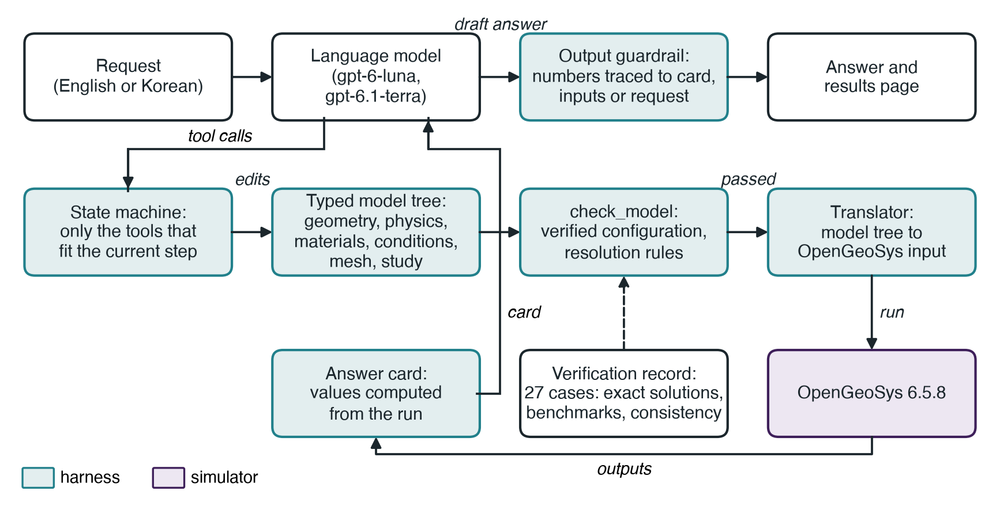
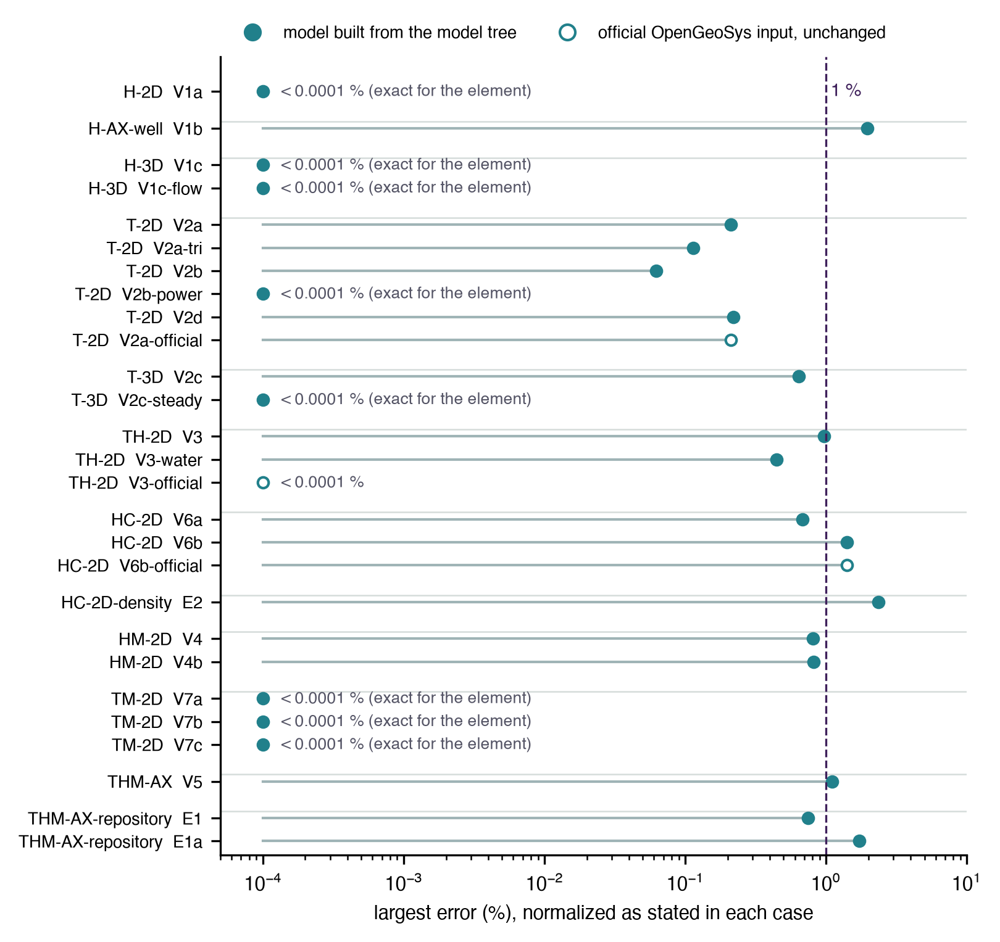
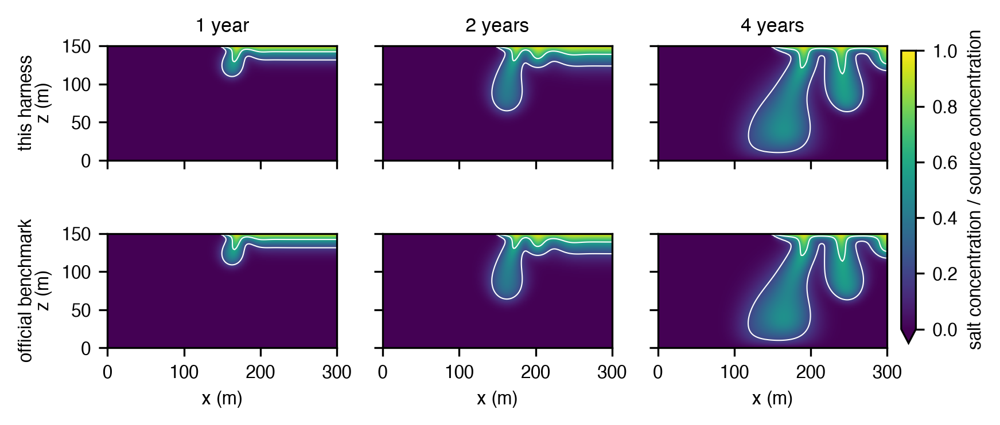
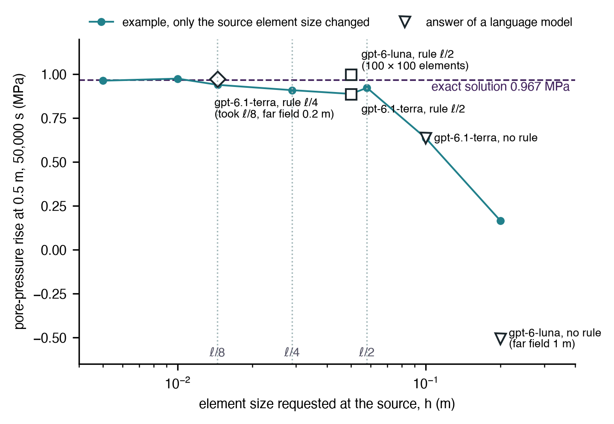

# 핵심 요점

- 에이전트가 한국어나 영어 요청을 받아 다중물리 해석 프로그램의 단계(기하와 격자부터 결과까지)를 밟아 OpenGeoSys 모델을 만들고, 답의 수치를 계산 결과, 모델 입력, 요청과 대조하여 확인한다
- 열, 지하수 흐름, 변형, 용질 이동의 12개 구성을 계산하며, 각 구성은 검증 사례를 갖는다. 사례 {{cases}}개 가운데 {{cases_within_1pct}}개가 기준과 1 % 이내, 모두 2.5 % 이내로 일치하였다
- 작은 OpenAI 모델 두 개로 한 최종 확인에서 모든 답의 검사 대상 수치가 모두 추적되었으나, 두 모델 모두 격자를 성기게 바꾸어 점 열원 질문 하나에 틀린 답을 냈고, 이를 계기로 해상도 규칙을 추가하였다

# 요약

GeoAI-THM Studio는 OpenGeoSys 6.5.8로 지하의 열전도, 지하수 흐름, 지하수 흐름에 의한 열 이동, 용질 이동, 압밀, 열응력과 열–수리–역학(thermo-hydro-mechanical, THM) 연계 현상을 모델링하고 계산하는 무료 비상업용 에이전트이다. 사용자가 문제를 설명하면 에이전트는 많아야 몇 가지만 되묻고, 다중물리 해석 프로그램의 단계(기하, 물리, 재료, 조건, 격자, 해석 설정, 계산, 결과)를 따라 약 스무 개의 도구로 모델을 조립하여 검사하고 계산한 뒤, 계산 결과에서 읽은 값과 그 값을 뒷받침하는 검증 기록, 결과 페이지를 함께 돌려준다. 언어 모델은 해석 입력 파일을 직접 쓰지 않고, 보고하는 수치는 프로그램이 계산한다. 언어 모델을 둘러싼 도구, 검사, 번역기, 출력 검사를 harness라 부른다. 본 문서에서는 에이전트의 작동 방식, 12개 구성을 뒷받침하는 검증 사례 {{cases}}개, 작은 언어 모델로 한 시험, 설치와 사용법, 0.1판의 한계를 설명한다. 상용 라이선스 없이 연계 문제의 1차 추정을 얻고자 하는 지하수 및 고준위 방사성 폐기물 분야의 연구자와 기술자, 그리고 에이전트가 수치해석 프로그램을 책임 있게 다루려면 무엇이 필요한지 알고자 하는 독자를 위해 작성하였다.

# 1. 목적

지하의 연계 모델은 지하수와 고준위 방사성 폐기물 분야에서 반복되는 질문에 답한다. 처분 용기의 열이 완충재와 암반으로 얼마나 퍼지는지, 열원 주변의 간극수압이 얼마나 오르는지, 양수정이 수위를 얼마나 낮추는지, 추적자나 방사성 핵종이 얼마나 빨리 이동하는지, 하중을 받은 점토층이 얼마나 침하하는지가 그 예이다. 상용 다중물리 프로그램은 그래픽 화면으로 이 질문에 답하고, OpenGeoSys(Bilke et al., 2019; Kolditz et al., 2012) 같은 공개 해석 프로그램은 익히는 데 시간이 걸리는 입력 파일로 답한다. GeoAI-THM Studio는 OpenGeoSys 앞에 언어 모델을 두어 질문을 한 문장으로 할 수 있게 하되, 모델 기술의 검사, 입력 파일, 계산, 보고하는 수치는 프로그램이 맡도록 하였다.

0.1판은 학습과 1차 추정을 위한 미리보기 판이다. 3절에 정리한 종류의 2차원, 축대칭, 단순한 3차원 문제를 풀고 그 범위 밖의 요청은 거절하며, 설계나 인허가, 안전성 평가에 쓰기 위한 것이 아니다. 대형 3차원 모델, 부지 특성을 반영한 모델, 3차원 역학 모델은 GeoAI Alignment, Inc.의 용역으로 다룬다.

# 2. 요청이 결과가 되기까지

**모델 트리.** 모든 모델은 형식이 정해진 모델 트리(model tree)로 기술되며, 다중물리 그래픽 프로그램의 단계를 따라 여섯 부분으로 나뉜다. 기하(층을 이룬 직사각형, 원형 포함체, 층을 이룬 상자, 우물이나 열원을 둘러싼 축대칭 형상), 물리(과정과 연계), 영역별 재료, 경계조건과 초기조건 및 원천, 격자 설정, 해석 설정(정상 또는 비정상, 종료 시각, 시간 간격, 출력 시각)이 그것이다. 모든 값에는 단위가 붙고("20 degC", "1e-5 m/s", "10 yr") SI 단위로 변환된다. 암반 지표 가열과 양수정부터 벤토나이트를 채운 처분공 속 발열 용기, 무거운 소금물이 가라앉는 Elder 문제까지, 자주 쓰는 문제에 대해서는 시작 예제 13개(`thmstudio examples`로 목록 확인, 5절)가 모델 트리를 채워 준다.

**도구와 단계.** 언어 모델은 도구를 통해서만 모델 트리를 바꿀 수 있으며, 상태 기계(state machine)가 그 순서를 정한다. 대화형 에이전트에서는 현재 단계에 맞는 도구만 보이는데, 모델이 초안 상태일 때는 4–6개, OpenGeoSys가 계산하는 동안에는 상태 확인 도구 하나뿐이다. 다른 프로그램에서 모델 컨텍스트 프로토콜(Model Context Protocol, MCP)로 쓸 때는 도구 21개가 모두 보이고, 같은 상태 검사가 호출할 때 적용된다. 단계에 맞지 않는 호출은 실패하는 대신 현재 상태와 다음 단계를 돌려주고, 어떤 수정이든 아래에서 설명하는 모델 검사의 앞선 통과를 무효로 하며, 실패한 수정은 모델을 바꾸지 않는다. 그림 1은 이 흐름을 보여 준다. 에이전트는 모델 하나에 많아야 세 가지를 묻되 질문마다 기본값을 제시하고, 사용자가 "알아서 해"라고 하면 시작 예제나 재료 라이브러리(표 A1)의 값으로 진행하면서 어떤 값이 기본값인지 밝힌다.

**격자 단계.** 격자 생성은 그래픽 프로그램에서와 같이 하나의 완전한 단계이다. 정렬 격자 생성기는 목표 크기, 경계와 층 경계 쪽으로의 점진적 세분, 우물이나 열원, 처분 용기 같은 이름 붙은 대상 주변의 국부 세분을 반영하여 사각형 또는 육면체 요소를 만든다. 별도 프로그램으로 실행하는 Gmsh(Geuzaine & Remacle, 2009)는 삼각형 격자와 원형 포함체를 만든다. 모든 격자는 요소 각도, 종횡비, 야코비안, 기하와 비교한 영역 면적, OpenGeoSys 격자 검사기로 점검하며, 계산 전에 격자 그림을 볼 수 있다(기준값은 표 A1). 이어서 검사 도구는 해상도 권고를 낸다. 물질 이동 모델의 격자 페클렛 수, 그리고 첫 출력 시각까지 열이 퍼진 거리 ℓ = √(κt₁)(κ는 재료 가운데 가장 작은 열확산계수, t₁은 첫 출력 시각)와 온도 고정 경계 요소 크기의 비교가 그것이며, 점 열원에서는 ℓ/8보다 큰 요소를 거절한다(4절). 비교 도구 compare는 요소 크기를 절반으로 줄여(시간 간격은 그대로) 모델을 다시 계산하고, 요청한 점이나 선에서의 최대 절대 차이를 보고한다.

**검사, 번역, 계산.** 계산 전에는 check_model 도구를 통과해야 한다. 이 도구는 검증을 통과하지 않은 물리·기하 조합(3절), 검증이 다루지 않는 대부분의 입력, 요소를 공유하는 경계에 걸린 상충하는 조건, 잘못 쓴 영역 이름, 강체 운동이 구속되지 않은 역학 모델을 거절한다. 그다음 번역기가 해당 OpenGeoSys 과정(액체 흐름, 열전도, 열 이동, 성분 이동, 수리–역학, 열–역학, 열–수리–역학)의 입력을 쓰며, 흐름·열·물질 이동에는 1차 요소를, 역학의 변위에는 2차 요소를 쓴다. 이어서 OpenGeoSys는 시간과 출력 크기에 상한을 둔 별도 프로세스로 실행된다. 반복법 선형 해법이 실패하면 직접법으로 한 번 다시 계산하며, 계산이 끝나면 모든 출력 파일을 읽어 값이 유한한지, 모든 해 변수가 있는지, 요청한 출력 시각이 모두 있는지 확인한다.

**결과 카드와 출력 검사.** 언어 모델은 보고하려는 값을 answer_card 도구에 요청하며, 이 도구가 계산 결과에서 읽은 값의 표를 결과 카드라 한다. 한 점이나 탐침에서의 값, 시작 이후의 변화량, 최댓값·최솟값·평균, 그리고 연계 하나(고체나 물의 열팽창, Biot 연계, 흡착, 붕괴)를 끈 비교 계산과의 차이를 요청할 수 있다. 카드의 각 행에는 실행, 위치, 시각, 검증 상태가 기록된다. 온도나 농도의 초기값과 고정값이 범위를 정하는 경우, 결과가 그 범위를 범위 폭의 1 %보다 크게 벗어나면 카드가 경고한다. 답이 사용자에게 가기 전에 출력 검사(output guardrail)가 답의 검사 대상 수치가 카드의 값, 모델 입력, 사용자 요청의 수치 가운데 하나와 일치하는지 확인한다. 수치는 부호를 빼고 본문에 쓴 자릿수로, 카드에 표시된 단위와 SI 단위의 값 모두와 비교하며, 인식하는 단위가 붙은 수치는 차원이 같은 카드 값이나 입력에서 와야 하나(카드 값은 백분율로도 인용할 수 있다) 요청의 수치는 어느 값이든 뒷받침할 수 있다. 뒤에 단위나 단위 같은 말이 붙지 않은 정수는 절댓값이 10 이하이거나 1900–2100 사이(연도)이면 검사하지 않고, 도구가 지나가며 알려 준 수치는 개수, 시간, 길이, 백분율은 뒷받침하나 온도, 압력, 속도, 유량은 뒷받침하지 않는다. 검사를 통과하지 못하면 모델은 답을 한 번 다시 써야 한다. 이 출력 검사는 OpenAI Agents SDK로 만든 에이전트에서 작동한다. 다른 프로그램이 MCP로 도구를 쓸 때는 결과 카드는 쓸 수 있으나 그 프로그램이 쓴 답은 검사하지 않는다.

**결과 페이지.** 계산 값을 보고하는 답에는 HTML 결과 페이지가 함께 만들어지며, 여기에 결과 카드, 그림, 인터넷 연결 없이 볼 수 있는 3차원 결과 화면, 검증 상태, 번역기가 한 변환의 목록이 담긴다.



# 3. 구성과 검증

구성(configuration)은 물리와 기하 유형의 조합이다. 0.1판에는 12개 구성이 있으며(표 1), 구성마다 검증 사례가 있다. 검증 사례는 모델 트리로 만든 모델을 OpenGeoSys 6.5.8로 계산하여 엄밀해, OpenGeoSys 공식 벤치마크의 출력, 또는 시연 구성의 경우 일관성 점검과 비교한다. 이와 별도로 OpenGeoSys 공식 입력을 그대로 계산하는 세 사례가 엔진 기준으로 표 1에 함께 실려 있으나, 아래의 계산 허용 규칙에는 들어가지 않는다. 허용 오차는 비교 전에 사례 파일에 적어 두었고, 오차는 사례 파일에 적은 대로 기준값이 초기값에서 가장 크게 변한 양, 그 지점의 변화량, 또는 1 K 같은 고정 척도로 정규화하였다. 기준으로는 양수정에 대한 Theis(1935) 해, 반무한 매질로의 열전도에 대한 여오차함수 해(Carslaw & Jaeger, 1959), Ogata and Banks(1961) 해와 흡착 및 붕괴를 포함한 방사성 핵종 이동 해(van Genuchten & Alves, 1982), Terzaghi 압밀(Terzaghi, 1943), 열탄성 엄밀해, Chaudhry et al.(2019)이 보정한 Booker and Savvidou(1985)의 점 열원 해, 그리고 무거운 소금물이 가라앉는 Elder(1967) 문제(Voss & Souza, 1987)를 썼다.

{{halving_sentence_ko}}

각 결과에는 그 결과를 낸 패키지와 OpenGeoSys의 판이 함께 기록되며, 구성은 설치된 판으로 그 구성의 모델 트리 사례가 모두 통과했을 때에만 계산된다. 사용자는 명령 `thmstudio verify`(5절)로 사례를 자기 컴퓨터에서 다시 계산할 수 있으며, 그 결과가 생기면 공개 기록 대신 그 결과를 쓴다. 공식 입력이나 출력을 읽는 네 사례에는 OpenGeoSys 6.5.8 시험 자료가 따로 필요하다(THIRD_PARTY_NOTICES.md).

사례 {{cases}}개가 모두 통과하였고 {{cases_within_1pct}}개가 1 % 이내로 일치하였다(그림 2). 가장 큰 오차는 공식 벤치마크 출력과 비교한 Elder 문제의 2.3 %와 이른 시각 양수정 근처의 Theis 수위 강하 2.0 %였다. 요소 유형에 대해 해가 정확한 사례는 반올림 오차 수준에서 일치하였다. 공식 입력과 에이전트가 만든 같은 문제를 모두 엄밀해와 비교한 경우, 두 계산은 엄밀해와 같은 정도로 일치하였다(반무한 매질 열전도 0.21 %, 방사성 핵종 이동 1.4 %).

Elder 문제에서 에이전트가 만든 모델과 공식 벤치마크의 소금물 손가락은 1년, 2년, 4년에 구별되지 않을 만큼 같았다(그림 3). 두 계산 모두 손가락 옆에서 농도가 0 아래(소금물 원천 농도의 −0.21)로 내려가는데, 이는 이 격자에서 안정화하지 않은 계산법이 보이는 과소 진동이며 결과 카드는 이를 경고로 보고한다. 완충재 속 발열 용기(THM-AX-repository)는 엄밀해가 없는 시연 구성으로, 에너지 수지, 격자 세분에 따른 수렴, 영역 면적, 점 열원과 같아지는 균질 극한으로 점검하였으며, 사례 E1에서 가장 큰 점검값 0.75 %는 요소 크기와 첫 시간 간격을 두 배로 했을 때의 간극수압 변화이다(그림 2).

*표 1. 구성과 검증 사례. 최대 오차는 사례에 포함된 비교 가운데 정규화한 최대 노름 오차의 최댓값이다(시연 구성은 일관성 점검의 최댓값). "공식 입력" 사례는 계산 허용 규칙 밖의 엔진 기준이다. 전체 표는 docs/VERIFICATION.md에 있다.*

{{TABLE1}}





**거절하는 입력.** 구성 안에서도 어떤 사례도 다루지 않는 입력은 대부분 거절한다. 용질 플럭스·유량 조건, 열 이동이나 용질 이동과 결합한 수리 저류, 열 이동이나 역학과 결합한 물 유입 조건이 그것이다. 어떤 사례도 관측하지 않는 용질 이동의 횡분산은 경고와 함께 계산한다. 반응 화학, 불포화 또는 2상 흐름, 벤토나이트 팽윤, 균열(fracture), 동결, 소성, 역학 모델의 중력, 3차원 역학처럼 구성 밖의 요청은 GeoAI Alignment 안내와 함께 거절하며, 표 A1의 요소 수 상한을 넘는 격자도 거절한다.

# 4. 작은 언어 모델로 한 시험

이 프로젝트는 harness를 잘 만들면 작은 모델도 모델링 작업을 끝까지 해낼 수 있음을 보이려 하였다. 개발과 시험에는 OpenAI 모델을 쓰지 않았고, OpenAI API는 마지막의 최종 확인 한 번에만 10달러 상한으로 사용하였으며, 여기에는 규칙을 바꾼 뒤 한 시나리오를 다시 수행한 것이 포함된다.

**대역 모델 시험.** Claude Haiku 5.5가 MCP 서버를 통해 시나리오 21개를 수행하였고, 시험 실행기가 그 답에 출력 검사를 적용하였다. 시나리오에는 영어와 한국어 요청, 조건을 모두 준 요청과 "알아서 해" 요청, 거절해야 하는 요청 두 개와 지원하지 않는 설정을 요구하는 요청 두 개(역학과 중력, 정상 상태 용질 이동), 후속 변경, 예제 없이 만드는 모델, 백분율로 적은 공극률, 말로 설명한 Elder 문제가 들어 있다. 시나리오가 요구하는 일(계산하고 카드를 만들기, 회사 안내와 함께 거절하기, 지정한 비교 계산 쓰기 등)을 하고 최종 답이 공개판 출력 검사를 통과하면 통과로 보았으며, {{l6_n}}개 가운데 {{l6_passed}}개가 통과하였다. 이 결과는 개발 중 다섯 차례 반복한 시험의 마지막 회차이며, 회차 사이에 같은 시나리오를 보며 지시문, 도구, 출력 검사를 고쳤으므로 그 시나리오에 맞춰 다듬은 harness를 잰 것이다. 통과하지 못한 시나리오는 지원하지 않는 정상 상태 용질 이동을 요청한 것으로, 모델은 요청을 그대로 들어줄 수 없다고 말하는 대신 비정상 모델을 1년 계산하고 그 결과를 정상 상태라고 하였다. 도구 호출 {{l6_calls}}번 가운데 {{l6_errors}}번이 오류를 돌려주었으나 모두 다음 단계 안내로 이어졌으며, 어느 것도 실행을 중단시키지 않았다.

**OpenAI API 최종 확인.** 시나리오 8개를 gpt-6-luna와 gpt-6.1-terra로 각각 한 번씩 수행하였으며, 시험 실행기의 오류로 첫 모델 호출 전에 실패한 gpt-6-luna 실행 세 번은 다시 수행하였다. 두 모델 모두 범위 밖 요청은 계산 없이 거절하였고, 나머지 14번은 결과 카드를 만들었으며, 모든 답의 검사 대상 수치가 카드, 입력, 요청으로 추적되었다. 범위 밖 요청을 빼면 처음 16번의 실행은 각각 도구 호출이 11–23번 필요하였다. 비용은 비용이 집계되기 전에 중단된 두 시도의 상한을 포함하여 모두 1.58달러였다. 대화 예시는 docs/EXAMPLE_CONVERSATION.md에 있다.

**최종 확인에서 찾은 것.** 모든 답을 그 답이 출발한 예제의 격자로 다시 계산하였다. 두 모델은 계산한 {{mesh_runs}}번 가운데 {{mesh_changed}}번 예제 격자를 바꾸었고 우물이나 열원 근처를 성기게 바꾼 경우가 많았으나, 다시 계산한 값은 한 시나리오를 빼고 모두 {{audit_other_max_pct}} % 이내(값 {{audit_other_n}}개 가운데 {{audit_other_within_02}}개는 0.2 % 이내)로 일치하였다.

예외는 포화 암반 속 300 W 점 열원이 간극수압을 얼마나 올리는지 묻는 시나리오였다. 두 모델 모두 열원 격자를(gpt-6-luna는 그 주변까지) 성기게 바꾸었고, 두 답 모두 계산된 수치만 인용하였으나 값은 −0.507 MPa와 0.635 MPa로 엄밀해 0.967 MPa(Booker & Savvidou, 1985; Chaudhry et al., 2019)와 달랐다.

열원 요소 크기를 바꾸어 가며 계산한 결과(그림 4), 간극수압은 열원 요소가 첫 출력 시각까지 열이 퍼진 거리 ℓ = √(κt₁)보다 충분히 작을 때에만 엄밀해에 다가갔다. 여기서 κ는 열확산계수, t₁은 첫 출력 시각이다. 이에 따라 먼저 요소가 ℓ/2보다 큰 점 열원을 거절하는 규칙을 넣었고(두 모델의 답 0.998, 0.887 MPa), 이어서 ℓ/4로 강화하였다. ℓ/4 규칙으로 다시 수행하자 gpt-6.1-terra는 격자가 거절된 뒤 격자를 세분하여 0.971 MPa를 보고하였다. 이 재실행에서 terra가 택한 크기는 규칙이 권한 ℓ/8이었다.

그러나 열원 요소 크기를 바꾼 계산에서 ℓ/4 자체는 오차가 약 6 %로 남았으므로, 공개판 check_model은 요소가 ℓ/8보다 크면 거절하고 ℓ/12를 권한다. ℓ/8은 이 예제를 검증 사례의 허용 오차 3 % 안에 두는 크기이다. gpt-6.1-terra는 첫 답에서 요소를 절반으로 줄인 비교를 하고 값이 격자에 민감하다고 적었으나 그 값을 그대로 답으로 보고하였으며, 그 결과를 근거로 답을 막는 규칙은 아직 없다. 이 확인에서 `thmstudio chat`이 두 번째 질문마다 실패하던 결함도 찾아 고쳤으며, 본 문서를 준비하면서 출력 검사의 결함 두 가지(한글에 붙어 쓴 수치, 카드에서 인용한 시간 단계 수)를 찾아 고쳤다. 같은 저자들이 ESS Open Archive에 제출한 프리프린트에서 이 결과가 수치해석 프로그램을 다루는 에이전트에 주는 의미를 논의한다.



# 5. 설치와 사용

GeoAI-THM Studio는 Apple Silicon의 macOS 15 이상과 Linux x86_64를 대상으로 Python 3.12에서 작동하도록 만들었다. Linux는 아래와 같이 에뮬레이션으로만 시험하였으며, Windows는 지원하지 않는다.

```
pip install "geoai-thm-studio[mesh-gmsh] @ git+https://github.com/geoaialignment/geoai-thm-studio@v0.1.0"
```

`mesh-gmsh` 선택 항목은 원형 포함체와 삼각형 격자에 쓰는 Gmsh를 설치한다. 최소 설치 상태의 Linux에서는 Gmsh에 시스템 라이브러리 여섯 개가 필요하다(Debian과 Ubuntu에서 `libgl1 libglu1-mesa libgomp1 libxcursor1 libxft2 libxinerama1`). 첫 삼각형 격자를 계산하기 전에 설치된 엔진이 답을 아는 작은 시험 문제를 푼다(표 A1). Apple Silicon에서 에뮬레이션으로 실행한 Linux x86_64용 OpenGeoSys 6.5.8은 이 시험을 통과하지 못하였으므로, 시험에 실패한 컴퓨터에서는 삼각형 격자를 거절하며, 사각형과 육면체 격자는 그대로 계산한다. 실제 Linux 컴퓨터에서의 시험은 아직 하지 않았다.

에이전트는 대화(`thmstudio chat --model gpt-6.1-terra`, 환경 변수에 OpenAI API 키 필요)로 쓰거나 Claude Desktop 같은 MCP 클라이언트에서(`thmstudio mcp`) 쓸 수 있다. `thmstudio examples`는 시작 예제를 보여 주고, `thmstudio verify`는 사용자 컴퓨터에서 검증을 다시 수행한다.

# 6. 한계

0.1판은 표 1의 12개 구성만 다루며, 결과는 학습과 1차 추정을 위한 것이다. 시험의 규모도 작다. 보고한 회차에서는 규칙을 바꾼 뒤 점 열원 시나리오를 다시 수행한 것을 빼면 시나리오마다 모델별로 한 번씩만 수행하였고, 대역 모델 결과는 같은 시나리오로 다섯 차례 반복한 개발 시험의 마지막 회차이며, 시나리오와 출력 검사, 채점 규칙은 모두 저자들이 만든 것이다. 모든 결과는 macOS에서 계산하였으며 Linux는 에뮬레이션으로만 시험하였다. 출력 검사는 수치가 어디에서 왔는지를 확인할 뿐 그 수치를 낸 모델이 적절한지는 확인하지 않는다. 이산화 선택 가운데 해상도 규칙으로 거절하는 것은 점 열원 주변 격자 하나뿐이고 나머지 해상도 검사는 권고이므로, 그 밖의 선택은 검증 사례와 결과 페이지를 보고 사용자가 판단해야 한다.

# 7. 라이선스, 인용, 연락처

코드는 PolyForm Noncommercial License 1.0.0, 문서와 예제, 검증 보고서는 CC BY-NC 4.0을 따르며 상업적 이용은 허용하지 않는다. 제3자 구성 요소는 각자의 라이선스를 따른다(OpenGeoSys는 BSD 3-Clause, Gmsh는 GPL이며 별도 프로그램으로만 실행한다). 인용: Park, E., Kim, T., & Park, J. (2026). GeoAI-THM Studio (Version 0.1.0). GeoAI Alignment, Inc. https://doi.org/{{doi}}. 소스: https://github.com/geoaialignment/geoai-thm-studio. 연락처: GeoAI Alignment, Inc., https://geoaialign.ai.

저자들은 이 소프트웨어를 비상업적 이용에 무료로 공개하고 그 범위를 넘는 상용 해석 용역을 제공하는 GeoAI Alignment, Inc. 소속이다. 이 밖에 저자들은 본 문서와 관련하여 이해관계가 없음을 밝힌다. 코드 작성과 시험, 본 문서의 초안 작성에 Claude(Anthropic)를 사용하였고 다른 언어 모델이 코드와 글을 검토하였다. 결과는 저자들이 확인하였으며 내용에 대한 책임은 저자들에게 있다.

# 부록 A. 설정과 검사

*표 A1. 0.1.0판의 설정과 검사. ℓ은 4절의 열 확산 거리이다.*

| 항목 | 설정 |
|---------------------|----------------------------------------------------------------|
| 소프트웨어 | OpenGeoSys 6.5.8(Python wheel), Gmsh 4.15.2(별도 프로그램으로 실행), OpenAI Agents SDK 0.24.0, Model Context Protocol SDK 2.3.0, Python 3.12 |
| 검증 허용 오차 | 비교 전에 사례마다 정함. 비정상 해는 대개 최대 노름 오차와 상대 l2 오차 1–3 %, 요소에 대해 해가 정확하면 10⁻⁶. 모든 사례와 허용 오차는 docs/VERIFICATION.md에 있음 |
| 격자 검사 | 뒤집힌 요소는 거절; 30°(사각형) 또는 15°(삼각형)보다 작은 각과 20:1을 넘는 종횡비는 경고; 영역 면적을 기하와 비교; 요소 수 상한은 역학 연계 15,000개, 그 밖의 2차원 60,000개, 3차원 120,000개 |
| 해상도 규칙 | 격자 페클렛 수 vh/(2D)(v 공극 유속, h 최대 요소 크기, D 분산계수; 열 이동은 그에 해당하는 수) 1 초과는 경고; 한 시간 간격에 전선이 요소 하나 넘게 이동하면(vΔt/h > 1) 경고; 비정상 열전도와 열 이동(T, TH)에서 온도 고정 경계 요소가 ℓ/2보다 크거나 (밀도와 비열이 주어진 재료에서) 종료 시각까지 열이 모델 크기의 절반 넘게 퍼지면 경고; 점 열원 요소가 ℓ/8보다 크면 거절하고 ℓ/12를 권함 |
| 비교 계산 | 고체 열팽창 끄기, 물 열팽창 끄기, Biot 연계 끄기, 흡착 끄기(지연계수 1), 붕괴 끄기, 요소 크기 절반(크기는 절반, 분할 수는 두 배) |
| 결과 카드 값 | 점이나 탐침의 값(요소 안에서 보간), 시작 이후 변화량, 모델 전체 절점값이나 선 위 201개 표본의 최댓값·최솟값·평균, 비교 계산과의 최대 절대 차이 |
| 엔진 자체 시험 | 삼각형 격자에서 2 m 띠를 가로지르는 300 K–290 K 정상 열전도; 최대 오차가 10⁻⁶ K 미만이면 통과; OpenGeoSys 판과 플랫폼마다 한 번 |
| 기본 재료값 | 출처가 붙은 대표값, src/thmstudio/agent/kb/materials.json |
| 시나리오와 채점 | tests/l6/scenarios.json(요청과 기대 결과), tests/l6/run_l6.py(채점), tests/final_api/run_final.py(API 확인), results/와 runs/(기록) |

# 참고문헌

{{REFS}}
